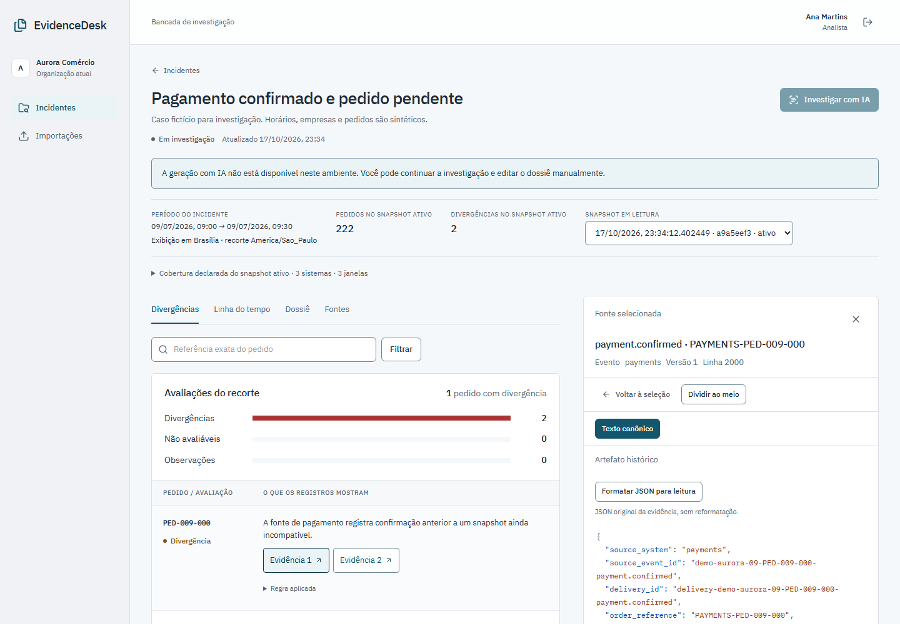
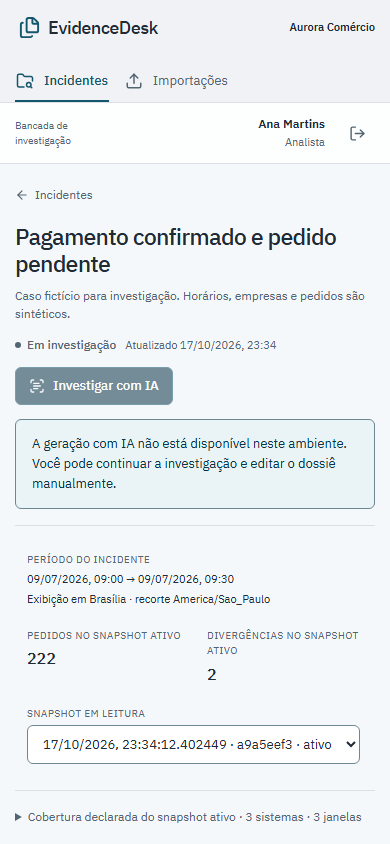
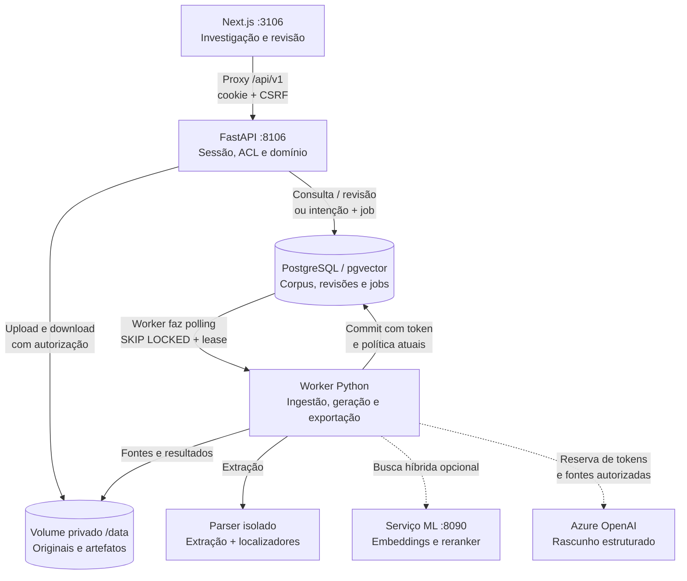
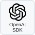
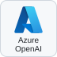
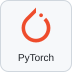

# EvidenceDesk

Investigação de pedidos com fontes verificáveis e revisão por outra pessoa.

<!-- Navegação do README -->
<p>
  <a href="#demonstração"></a>
  <a href="#arquitetura"></a>
  <a href="#executar-localmente"></a>
  <a href="#verificação-e-evidências"></a>
  <a href="https://www.linkedin.com/in/arthur-joanes-6a2967373/"></a>
</p>

## Visão geral

O EvidenceDesk investiga casos em que o pagamento foi confirmado, mas o pedido continua pendente. A aplicação reúne eventos, snapshots e documentos; usa [regras determinísticas](backend/src/evidencedesk/reconciliation/rules.py), oferece rascunhos opcionais de IA e exige outra conta para aprovar uma revisão. Os dados da demonstração são sintéticos.

<a id="na-prática"></a>
<a id="uma-investigação-do-início-ao-fim"></a>

## Demonstração



Abra um incidente para consultar as divergências e os registros que as sustentam. O resumo conta pedidos distintos e separa divergências, observações e avaliações inconclusivas. Um pedido pode ter mais de uma divergência.



O período pertence ao incidente. A seleção de snapshot e a busca por pedido atualizam os registros e o resumo. [Capturas e ambiente](docs/screenshots.md).

1. Importe os arquivos e confira a cobertura das fontes.
2. Investigue os pedidos e monte o dossiê.
3. Envie a conclusão para outra conta revisar.
4. Exporte a revisão aprovada.

A geração por IA é opcional. O fluxo manual funciona com ela desativada. A aplicação aponta inconsistências entre registros; a equipe investiga a causa e faz a correção no sistema de origem.

[Roteiro da demonstração](docs/demo.md) · [Teste da jornada](frontend/e2e/payment-story.spec.ts).

<a id="implementação"></a>
<a id="arquitetura-e-escolhas"></a>

## Arquitetura

O EvidenceDesk é um monólito modular com dois processos de backend: a API atende consultas e admite operações; o worker executa os trabalhos demorados. No perfil local do [Compose](infra/compose/compose.yaml), o banco concentra domínio, fila e orçamento.



As setas pontilhadas mostram as integrações opcionais. API e worker compartilham o pacote Python e o banco. O navegador consulta a API pelo proxy do Next.js.

| Fronteira           | O que acontece nela                                                                                          | Implementação                                                                                                                                       |
| ------------------- | ------------------------------------------------------------------------------------------------------------ | --------------------------------------------------------------------------------------------------------------------------------------------------- |
| Navegador → API     | O proxy preserva sessão e streaming; o backend confere CSRF e acesso ao recorte.                             | [Proxy](frontend/src/app/api/v1/%5B...path%5D/route.ts), [identidade](backend/src/evidencedesk/identity/service.py)                                 |
| HTTP → fila         | Finalizar importação, pedir geração ou exportar grava a intenção e o job antes de responder.                 | [Ingestão](backend/src/evidencedesk/ingestion/routes.py), [jobs](backend/src/evidencedesk/jobs/service.py)                                          |
| Worker → publicação | Parsing e rede ocorrem fora da transação; o commit revalida lease, token de execução e política.             | [Dispatcher](backend/src/evidencedesk/worker.py), [processamento](backend/src/evidencedesk/ingestion/processing.py)                                 |
| Fontes → decisão    | O snapshot fixa o corpus; regras calculam divergências, e uma revisão imutável exige decisão de outra conta. | [Conciliação](backend/src/evidencedesk/reconciliation/rules.py), [revisões](backend/src/evidencedesk/reviews/service.py)                            |
| Aplicação → IA      | Busca lexical funciona sem ML; geração recebe fontes delimitadas e não aprova nem altera pedidos.            | [Ferramentas de leitura](backend/src/evidencedesk/investigations/tools.py), [admissão de tokens](backend/src/evidencedesk/investigations/budget.py) |

O percurso começa no manifesto e upload, passa por extração, snapshot, incidente e conciliação, e termina no dossiê revisado e na exportação HTML autorizada. O dossiê pode ser manual ou partir de um rascunho opcional. A interface acompanha geração por eventos SSE persistidos, retomáveis com `Last-Event-ID`.

No perfil local, `db_data`, `evidence_data` e `deletion_ledger` são volumes distintos no mesmo host. O adaptador Blob e a infraestrutura Azure têm bloqueadores de implantação próprios. A [arquitetura detalhada](docs/architecture.md) descreve contratos entre módulos, sequência de importação, modelo de dados, falhas e observabilidade.

<a id="o-que-eu-implementei"></a>
<a id="stack"></a>

## Stack e decisões

<p>
  
  
  
  
  
  
  
  
  
  
</p>

Geração opcional por Azure OpenAI, integrada pelo SDK OpenAI:

<p>
  
  
</p>

O perfil `ml` usa PyTorch e Transformers/Sentence Transformers para embeddings e reranking locais. MLflow registra os experimentos do laboratório.

<p>
  
  
  
</p>

| Componente                          | Papel e compromisso                                                                    |
| ----------------------------------- | -------------------------------------------------------------------------------------- |
| Python, FastAPI e SQLAlchemy        | Domínio, autorização, persistência, importação e operações assíncronas                 |
| Pydantic                           | Valida os contratos de ingestão, conciliação e geração                                 |
| PostgreSQL                         | Dados, fila, isolamento e recuperação; o mesmo banco concentra essas responsabilidades |
| pgvector                           | Extensão do PostgreSQL para embeddings e busca vetorial no perfil opcional `ml`         |
| TypeScript, React e Next.js         | Interface para investigar, editar, revisar e exportar                                  |
| Docker Compose                      | Operação local com volumes próprios                                                    |
| SDK OpenAI e Azure OpenAI           | Geração opcional; o fluxo manual e lexical permanece disponível                       |
| PyTorch, Transformers e Sentence Transformers | Embeddings e reranker locais no perfil opcional `ml`                         |
| MLflow                             | Registro dos experimentos do laboratório; candidato treinado sem promoção             |

[Fontes e licenças dos ícones](docs/stack/README.md).

As versões estão nos manifests do [backend](backend/pyproject.toml), do [frontend](frontend/package.json) e no [Compose](infra/compose/compose.yaml). A integração Azure exige configurar o deployment e o endpoint conforme o [contrato](backend/src/evidencedesk/model_runtime/azure.py).

Conciliação, revisão e geração têm responsabilidades separadas: uma citação válida estruturalmente ainda precisa sustentar o texto. O candidato treinado permanece sem promoção e sem adjudicação humana. O [model card](docs/model-card.md) reúne o protocolo, as medições e os limites dessa avaliação.

<a id="executar-e-verificar"></a>
<a id="rodar-localmente"></a>

## Executar localmente

Use Docker com containers Linux, Compose **2.24.4+** e Python **3.11+** para a CLI do host. Os overlays usam [`!override`](infra/compose/integration.yaml), que requer essa [versão do Compose](https://docs.docker.com/reference/compose-file/merge/#replace-value). O build baixa dependências; a geração Azure exige configuração própria e pode ter cobrança do provedor.

```powershell
python scripts/ops.py config
python scripts/ops.py build
python scripts/ops.py start
python scripts/ops.py seed
```

Abra [localhost:3106](http://127.0.0.1:3106). Use `ana@aurora.demo` para investigar ou `bruno@aurora.demo` para revisar, com a senha pública da demonstração `EvidenceDesk-demo-2026!`. As contas do [seed](backend/src/evidencedesk/seed.py) são sintéticas e os serviços ficam publicados em loopback.

```powershell
python scripts/ops.py stop
```

`stop` preserva os volumes. O [runbook local](docs/runbooks/local.md) detalha instalação, Azure opcional e diagnóstico.

<a id="verificar-e-explorar"></a>

## Verificação e evidências

Os comandos de testes, lint, tipos e build estão no [guia de desenvolvimento](docs/development.md). O [guia do frontend](docs/frontend.md) descreve os contratos de navegação e autorização; o [runbook de CI](docs/runbooks/ci.md) prepara bancos isolados para as jornadas de navegador.

O [guia de verificação](docs/verification.md) reúne os resultados por versão. Os testes cobrem importação, isolamento entre organizações, revisão por outra conta e exportação. O [workbench de avaliação](docs/runbooks/evaluation-workbench.md) serve para conferir respostas e fontes; a avaliação humana ainda está pendente.

```powershell
python -m pip install --require-hashes -r scripts/requirements-docs.lock
python scripts/check_repository_docs.py
```

O [checker](scripts/check_repository_docs.py) verifica os caminhos e as âncoras dos links locais.

<a id="limites-e-manutenção"></a>
<a id="ia-e-escopo"></a>

## Limites e segurança

[Política de segurança e relato de vulnerabilidades](SECURITY.md) · [Modelo de ameaças](docs/threat-model.md) · [Scans das imagens](docs/publication-security.md) · [Revisão dos controles em 3 de outubro de 2026](docs/SECURITY-REVIEW-2026-10-03.md).

A aplicação não corrige pedidos nem executa [ferramentas de escrita](backend/src/evidencedesk/investigations/tools.py) nos sistemas de origem. As permissões são verificadas fora do modelo. Uma chamada com resultado desconhecido conserva sua [reserva de tokens](backend/src/evidencedesk/investigations/budget.py); a contabilidade é de tokens, não uma tabela monetária.

O [pacote de avaliação humana](evals/human-review/package.json) tem 60 casos de desenvolvimento em oito famílias e ainda não foi executado.

O [workbench](docs/runbooks/evaluation-workbench.md) exige duas avaliações independentes por resposta e uma decisão de outro revisor. A [suíte adversarial](evals/adversarial.py) testa os contratos com transporte simulado.

A infraestrutura Azure foi validada localmente e ainda não foi implantada. As pendências estão no [runbook hospedado](docs/runbooks/azure-hosted.md).

## Documentação

[Padrão compartilhado da documentação](docs/padrao-documentacao.md) · [Fontes e afirmações](docs/fontes-e-afirmacoes.md).

| Para consultar               | Documento                                                                                                                                                            |
| ---------------------------- | -------------------------------------------------------------------------------------------------------------------------------------------------------------------- |
| Explorar o produto           | [Demo](docs/demo.md) · [casos e decisões](docs/problem-solution.md)                                                                                                  |
| Implementar e testar         | [Arquitetura](docs/architecture.md) · [API](docs/api-contract.md) · [dados](docs/data-contract.md) · [desenvolvimento](docs/development.md)                          |
| Operar e recuperar           | [Local](docs/runbooks/local.md) · [backup/restore](docs/runbooks/backup-restore.md) · [retenção](docs/runbooks/retention.md)                                         |
| Entender IA e orçamento      | [Model card](docs/model-card.md) · [modelos locais](docs/model-service.md) · [tokens](docs/token-budget.md)                                                          |
| Conferir riscos e resultados | [Política de segurança](SECURITY.md) · [threat model](docs/threat-model.md) · [publicação](docs/publication.md) · [fontes e afirmações](docs/fontes-e-afirmacoes.md) |
| Conferir imagens             | [Origem e reprodução](docs/screenshots.md)                                                                                                                           |
| Desenvolver a interface      | [Frontend](docs/frontend.md) · [tipografia e acessibilidade](docs/brand.md)                                                                                         |

## Autor e licença

<p><a href="https://www.linkedin.com/in/arthur-joanes-6a2967373/"> <strong>Arthur Joanes no LinkedIn</strong></a></p>

[Licença MIT](LICENSE). Ícones Devicon e Simple Icons: [fontes e licenças](docs/stack/README.md). LinkedIn: [Devicon, licença MIT](docs/stack/LICENSE.devicon).
