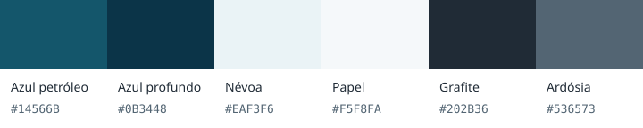

# Identidade visual do EvidenceDesk

O azul petróleo identifica as ações e as fontes em conferência. O azul profundo dá peso à marca e ao estado ativo; superfícies claras mantêm o texto dos registros como centro da investigação. A mesma paleta aparece na aplicação e no workbench local. O símbolo de documentos conserva seu desenho, agora com as cores da marca.

| Cor           | Valor     | Uso                                                             |
| ------------- | --------- | --------------------------------------------------------------- |
| Azul petróleo | `#14566B` | Ação principal, links, ícone e destaque da citação              |
| Azul profundo | `#0B3448` | Nome da marca e hover da ação principal                         |
| Névoa         | `#EAF3F6` | Seleção, contexto da alegação e navegação ativa                 |
| Papel         | `#F5F8FA` | Fundo da bancada, preservando branco nas superfícies de leitura |
| Grafite       | `#202B36` | Texto principal                                                 |
| Ardósia       | `#536573` | Texto secundário e proveniência                                 |

Os tokens `--brand`, `--brand-strong` e `--brand-soft` expressam esses papéis. Os aliases anteriores continuam para manter os componentes existentes. Foco usa `#147A91`; limites necessários de controles usam `#6D8795`. Divisórias podem ser mais discretas que campos interativos.

Erro (`#AA3434`), sucesso (`#32664C`) e aviso (`#815617`) continuam separados da marca. Cada estado tem rótulo ou mensagem: a cor sozinha não indica aprovação, falha ou falta de evidência.

IBM Plex Sans permanece na aplicação, com IBM Plex Mono em identificadores e JSON. O HTML offline conserva Segoe UI/Cambria, sem baixar fontes. Títulos, citações e controles têm a hierarquia da tarefa; uma apresentação visual não substitui fonte, autorização ou julgamento.

## Contraste dos tokens

Razões calculadas pela luminância relativa sRGB do WCAG. Elas descrevem estas combinações, sem certificar todas as páginas e estados.

| Combinação                     | Contraste |
| ------------------------------ | --------: |
| Branco sobre azul petróleo     |    8,16:1 |
| Grafite sobre branco           |   14,38:1 |
| Ardósia sobre papel            |    5,66:1 |
| Azul petróleo sobre névoa      |    7,25:1 |
| Foco sobre branco              |    4,97:1 |
| Limite de controle sobre papel |    3,55:1 |

A [revisão de interface](uiux-review-20261012.md) e os [checks executados](evidence/uiux-20261012/verification.json) registram o contraste automatizado nos estados reais, teclado e tamanhos de tela. [WCAG 2.2](https://www.w3.org/WAI/WCAG22/quickref/) orienta contraste de texto e componentes, além de foco e reflow.
