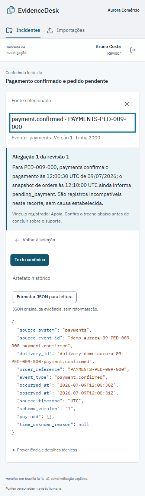

# Capturas da interface

## Leitor de citação



O leitor mostra a alegação da revisão junto ao texto da fonte. A [demo](demo.md) apresenta o caso de pagamento; o [guia do frontend](frontend.md) descreve navegação, recortes e autorização.

## Inventário de setembro

As **17 capturas históricas de setembro** mostram a aplicação com dados sintéticos. Identidades, snapshots, usuários, horários e estados pertencem às respectivas execuções. Uma imagem corrente não altera os resultados de aprovação, restauração ou conciliação desses registros. Os ícones da stack e separadores SVG do README são recursos gráficos.

| Conjunto                                                                                  | Quantidade | Tratamento                                                                                                                                                              |
| ----------------------------------------------------------------------------------------- | ---------: | ----------------------------------------------------------------------------------------------------------------------------------------------------------------------- |
| [Divergências](images/workspace-desktop.png) e [texto da fonte](images/source-mobile.png) |          2 | Recortes da aplicação com a conta sintética Ana.                                                                                                                        |
| [Texto JSON da fonte](images/source-json-mobile.png)                                      |          1 | Recorte de 288 × 377 px, obtido diretamente do leitor.                                                                                                                  |
| [Jornada de pagamento](demo.md)                                                           |          8 | Capturas da execução de 22/09 preservadas; sete hashes conferidos no registro de navegador e um no registro de recorte. Inclui dois recortes declarados, sem redesenho. |
| [Revisão e restauração](restore-read-story.md)                                            |          6 | Provas históricas preservadas e seis hashes conferidos no manifesto da rodada.                                                                                          |

O [inventário inicial](evidence/screenshots-20260922.json) conserva hashes, dimensões e origens dos 16 arquivos anteriores ao recorte de JSON. Os registros da [jornada de pagamento](demo.md) e da [restauração](restore-read-story.md) identificam as fontes e os resultados funcionais de cada execução. Aprovação por contas operadas por automação verifica o fluxo; não equivale a avaliação semântica humana.

Capturas extensas das execuções históricas aparecem como links. Os recortes vêm do navegador ou do registro nativo documentado, com o texto e os dados daquela execução.

## Reproduzir a leitura

Com a aplicação e o seed local disponíveis, a partir de `frontend`:

```powershell
$env:ED_E2E_BROWSER_CHANNEL = 'msedge'
$env:ED_E2E_BASE_URL = 'http://127.0.0.1:3106'
$env:ED_E2E_ARTIFACT_DIR = Join-Path $env:TEMP 'evidencedesk-capturas'
npm run test:e2e -- json-syntax.spec.ts visual.spec.ts
```

A saída fica fora do repositório. Inspecione fonte e texto carregados antes de selecionar capturas; preserve os arquivos vinculados a manifestos históricos. Para outros sistemas, use um navegador instalado compatível com Playwright.
